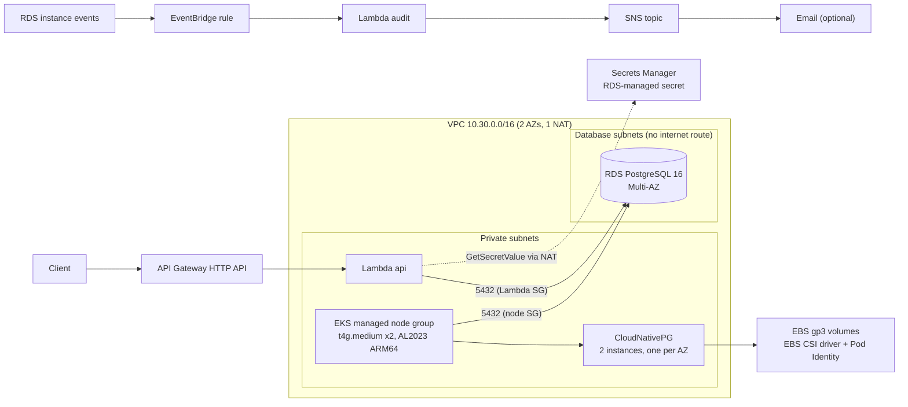

# EKS with CloudNativePG, Multi-AZ RDS and serverless on AWS

   

An EKS cluster on Graviton nodes that runs PostgreSQL inside Kubernetes with the CloudNativePG operator, next to a managed Multi-AZ RDS PostgreSQL instance for comparison. Around them sit a serverless API (API Gateway + Lambda in the VPC) and an event-driven audit pipeline (EventBridge -> Lambda -> SNS). The infrastructure uses the community Terraform modules for VPC, EKS and RDS.

Part of a three-project series:
1. [PostgreSQL operations on RDS](https://github.com/monahgh/aws-postgres-operations)
2. [Three-tier app on ECS Fargate with Aurora and RDS Proxy](https://github.com/monahgh/aws-three-tier-ecs-aurora)
3. **EKS with CloudNativePG, Multi-AZ RDS and serverless** (this repo)

## What it demonstrates

| Area | What the lab covers |
|---|---|
| EKS access | Access entries (`authentication_mode = "API"`) instead of the legacy `aws-auth` ConfigMap |
| Workload identity | EKS Pod Identity instead of IRSA for the EBS CSI driver: no OIDC provider to manage |
| Stateful Kubernetes | CloudNativePG cluster with 2 instances forced into different AZs, on encrypted gp3 EBS volumes |
| Managed vs self-managed Postgres | Multi-AZ RDS (AWS handles standby and failover) next to CloudNativePG (operator-managed failover, full control, more to operate) |
| Serverless | HTTP API -> Lambda inside the VPC with SG-to-SG access to RDS; audit Lambda outside the VPC |
| Event-driven operations | RDS instance events routed by EventBridge to a Lambda that publishes to SNS (optional email) |
| Network isolation | Database subnets with no route to the internet in either direction |

## Architecture



An editable diagram is in [docs/architecture.drawio](docs/architecture.drawio).

## Design decisions

| Decision | Why |
|---|---|
| Access entries, cluster creator as admin | Access is managed as AWS resources rather than a ConfigMap that is easy to break. `extra_eks_admin_arns` adds admins when the console identity differs from the Terraform identity |
| Pod Identity over IRSA | No OIDC provider; the role simply trusts `pods.eks.amazonaws.com`, and the association is declared on the addon |
| `vpc-cni` and `eks-pod-identity-agent` before compute | Nodes join with networking and identity ready, so addons that depend on them start cleanly |
| Graviton managed node group in private subnets | Cheaper per vCPU; managed rolling updates with `max_unavailable = 1`; SSM policy attached so nodes are reachable without SSH |
| StorageClass with `WaitForFirstConsumer` | EBS volumes are bound to one AZ, so the volume is created where the pod is scheduled |
| Required pod anti-affinity on `topology.kubernetes.io/zone` | The CloudNativePG primary and replica can never share an AZ |
| Database subnets without IGW or NAT routes | The data tier cannot reach out or be reached from outside |
| SG-to-SG rules for RDS | 5432 is allowed from the EKS node security group and the Lambda security group, not from CIDR ranges |
| `manage_master_user_password = true` | RDS generates and stores the password in Secrets Manager; it never appears in Terraform state |
| API Lambda inside the VPC, audit Lambda outside | Only the function that needs RDS pays for VPC networking; the audit function only calls SNS |
| Least-privilege Lambda roles | The API role can read one secret; the audit role can publish to one topic |
| Community modules for VPC, EKS and RDS | Large, well-tested building blocks; Lambda, API Gateway, EventBridge and SNS stay as plain resources |
| Subnet tags for load balancers | `kubernetes.io/role/elb` and `internal-elb` let the AWS Load Balancer Controller discover subnets |

## Repository layout

```text
terraform/   VPC, EKS and RDS (modules), Lambda, API Gateway, EventBridge, SNS
k8s/         namespace, gp3 StorageClass, CloudNativePG cluster
lambda/      api (HTTP API + /ingest) and audit (EventBridge -> SNS)
scripts/     deploy_k8s.sh, index_advisor.sh
bootstrap/   create / delete the S3 bucket for Terraform state
docs/        architecture diagram
```

## Deploy

Prerequisites: AWS CLI v2, Terraform >= 1.11.1, kubectl, an IAM admin profile (not root). Confirm that the Kubernetes version in `variables.tf` is available in your region.

```bash
export AWS_PROFILE=lab

# 1. State bucket (once per account)
bash bootstrap/create_state_bucket.sh

# 2. Backend config (gitignored) and apply
cd terraform
cp backend.hcl.example backend.hcl    # set your account ID
terraform init -backend-config=backend.hcl
terraform plan -out=tfplan
terraform apply tfplan

# 3. Kubernetes resources: CloudNativePG operator, StorageClass, Postgres cluster
$(terraform output -raw kubeconfig_command)
bash ../scripts/deploy_k8s.sh
kubectl get cluster -n pgops
```

Restrict `cluster_public_access_cidrs` to your own IP (`x.x.x.x/32`) for anything longer-lived than a lab session.

## Things to try

| Check | How |
|---|---|
| Instances spread across AZs | `kubectl get pods -n pgops -o wide` and `kubectl get nodes -L topology.kubernetes.io/zone` |
| EBS volumes created by the CSI driver | `kubectl get pvc -n pgops`, then the volumes in the EC2 console |
| CloudNativePG failover | Delete the primary pod (`kubectl delete pod -n pgops <primary>`) and watch the operator promote the replica: `kubectl get cluster -n pgops -w` |
| RDS failover and the audit pipeline | `aws rds reboot-db-instance --db-instance-identifier eks-lab-postgres --force-failover`, then check the audit Lambda logs (and email, if `alert_email` is set) |
| API | `curl "$(terraform output -raw api_url)/health"` |
| Index suggestions | `scripts/index_advisor.sh` prints the slowest `pg_stat_statements` entries as a prompt for an LLM-based index review |

## Status and next steps

- `lambda/api` is a scaffold: `/health` works, and `/ingest` validates and accepts JSON but does not write to the database yet. Next step: bundle a pure-Python driver (e.g. `pg8000`) and read credentials from `DB_SECRET_ARN`.
- The CloudNativePG manifest in `scripts/deploy_k8s.sh` defaults to release 1.25.0; check for the current release before deploying.
- Production additions: private-only API endpoint, Karpenter or Cluster Autoscaler, CloudNativePG backups to S3 (Barman), RDS Proxy for Lambda connections, VPC endpoints instead of NAT.

## Cost and teardown

The bill is dominated by the EKS control plane (~$0.10/hour), two `t4g.medium` nodes, the NAT gateway and the Multi-AZ RDS instance. Destroy after each session.

Delete the Kubernetes resources first so the EBS volumes (and any load balancers) are released, then destroy:

```bash
kubectl delete -f ../k8s/20-cnpg-cluster.yaml
terraform destroy
```

Delete the state bucket last with `bash bootstrap/delete_state_bucket.sh` (skip it if other projects still use the bucket).
